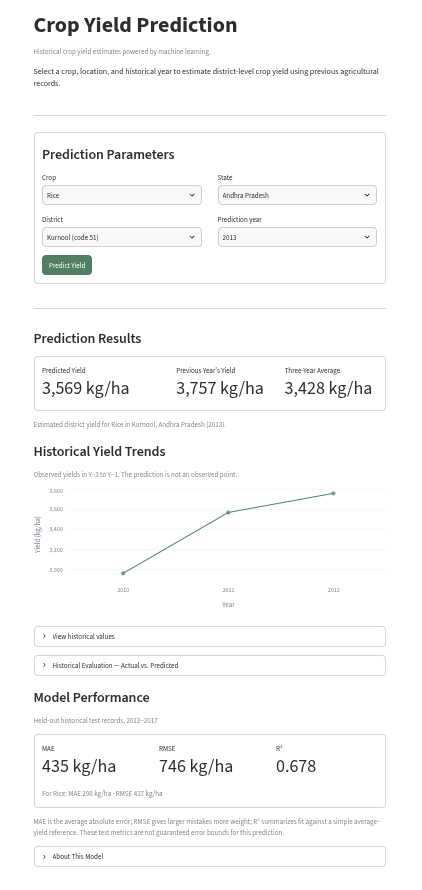
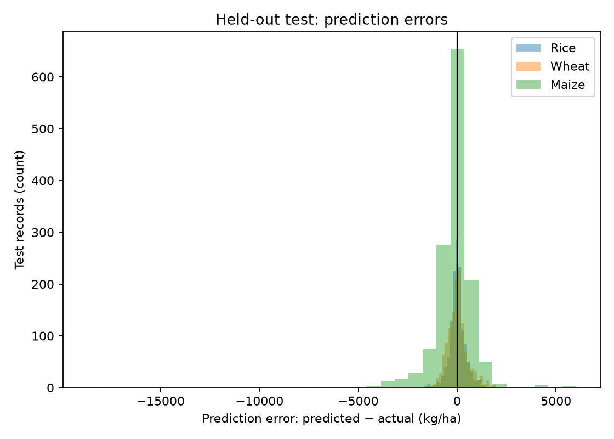

# Crop Yield Prediction System

A Streamlit application that uses Ridge Regression and historical agricultural data to estimate district-level crop yields in India. It supports **Rice, Wheat, and Maize** and shows the historical yields behind each prediction.



*Streamlit interface showing a historical Rice prediction and model performance.*

## Key Features

- Predict yields for historical years in kg/ha.
- Select a crop, state, district, and prediction year.
- Retrieve the previous three calendar years of yields automatically.
- Explore yield trends and compare predictions with recorded outcomes.
- View held-out model performance and crop-specific metrics.

## Tech Stack

Python | Pandas | NumPy | scikit-learn | Streamlit | Altair

## ML Pipeline

Dataset → Cleaning → Feature Engineering → Model Training → Evaluation → Streamlit App

The pipeline creates features from observed yields in the three preceding calendar years. Ridge Regression was selected by validation RMSE after comparison with Random Forest and a historical three-year-average baseline.

## Model Performance

Final held-out evaluation used **4,000 historical records from 2013–2017**.

| Model | MAE | RMSE | R² |
| --- | ---: | ---: | ---: |
| Ridge Regression | 434.60 | 746.16 | 0.678 |

MAE and RMSE are measured in **kg/ha**. R² describes model fit; it is not percentage accuracy.

<p align="center">
  
  
</p>

## Installation and Usage

Obtain an authorized, compatible dataset from the [official ICRISAT District Level Data resource](https://www.icrisat.org/resources/data/district-level-data) and place it at `data/raw/ICRISAT-District Level Data.csv`. The dataset is **not included** because redistribution permission for the local copy has not been confirmed.

From the project root:

```bash
python3 -m venv .venv
.venv/bin/python -m pip install -r requirements.txt
.venv/bin/python -m src
.venv/bin/python -m streamlit run app.py
```

The preparation command creates the local processed data needed by the app. The saved Ridge model and evaluation reports are included; launching the app does not retrain the model.

## Limitations

- The model demonstrates historical predictions, not current-year forecasts.
- Predictions are district-level estimates, not farm-specific recommendations.
- Three consecutive years of valid historical yields are required.
