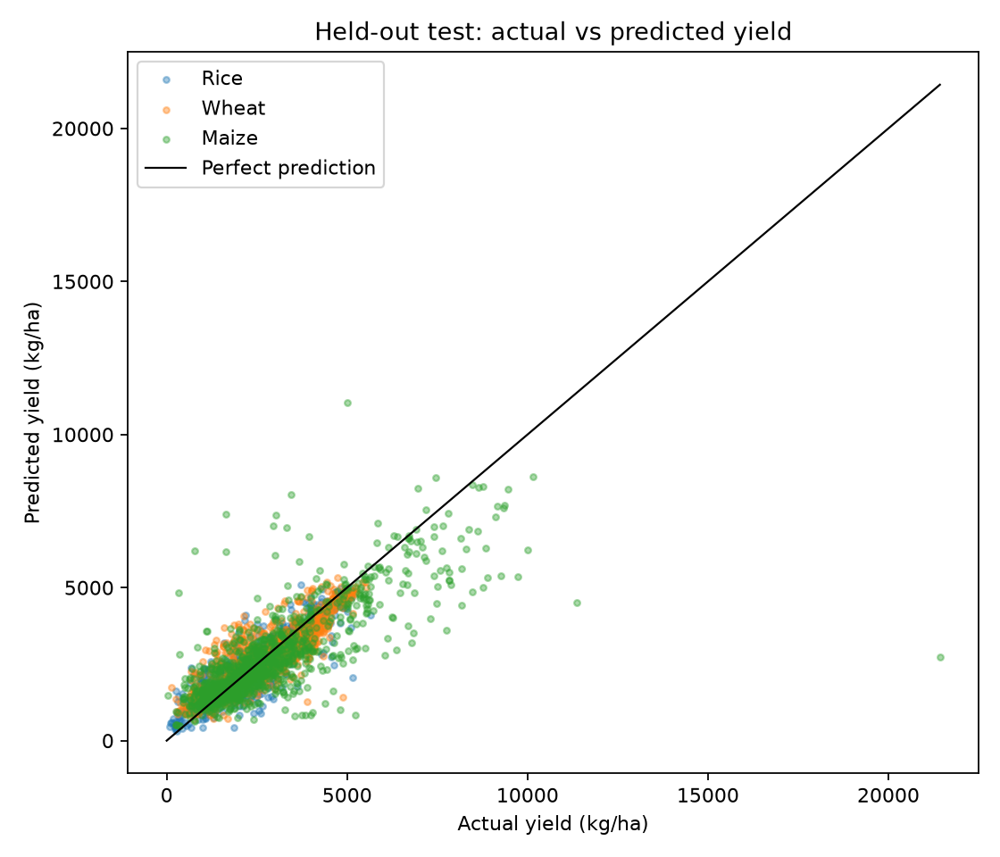

# Crop Yield Prediction System

A Streamlit application for exploring **historical, district-level crop yield predictions** in India. It supports **Rice, Wheat, and Maize** and predicts yield in **kilograms per hectare (kg/ha)** from the three preceding calendar years of observed yields. The saved Ridge Regression model and evaluation reports are included. The source and row-level processed datasets are kept outside version control because redistribution rights for the exact CSV have not been established.

## Problem and scope

Historical yield varies by crop, location, and year. This project asks whether a small regression model can improve on a simple rule: predict the average yield of the previous three years. It provides a reproducible data preparation pipeline, chronological model evaluation, and an interface for retrospective predictions in **2013–2017**. The application is a historical demonstration, not a live forecast for the current growing season.

## Dataset and attribution

The local source file is named `data/raw/ICRISAT-District Level Data.csv`. It is attributed to the **International Crops Research Institute for the Semi-Arid Tropics (ICRISAT)** and its [District Level Data resource](https://www.icrisat.org/resources/data/district-level-data). ICRISAT's [VDSA meso documentation](https://vdsa.icrisat.org/vdsa-mesodoc.aspx) describes the wider district database. The particular local CSV has **12,418 district-year rows, 311 district codes, 20 states, and years 1978–2017**. It includes district and state identifiers plus crop area (thousand hectares), production (thousand tons), and reported yield (kg/ha). The pipeline uses only the Rice, Wheat, and Maize fields.

**Data availability and permission:** ICRISAT publishes a public data page and a [data request form](https://vdsa.icrisat.org/vdsa-requestData.aspx). Its [general copyright statement](https://www.icrisat.org/public/privacy-policy) describes noncommercial sharing with attribution, but the exact provenance and dataset-specific redistribution terms of this local CSV are unverified. Public access alone does not establish permission to include this copy in a public repository. The raw CSV, cleaned and feature CSVs, and row-level quality issue report are therefore ignored by Git. Obtain an authorized, compatible export directly from ICRISAT/VDSA and follow its terms; do not substitute an arbitrary third-party GitHub copy.

Place the export at `data/raw/ICRISAT-District Level Data.csv`. It must have these columns: `Dist Code`, `Year`, `State Name`, `Dist Name`, and, for each of `RICE`, `WHEAT`, and `MAIZE`, `AREA (1000 ha)`, `PRODUCTION (1000 tons)`, and `YIELD (Kg per ha)`. A different export or time span may change results or require adapting the input mapping. The local reference CSV has SHA-256 `8532cbf0f554005c0d1d3301ab6077cf02b6889735db7438753e7394e90e740c`; this helps identify the version used to generate the included reports, but is not a download link or permission grant.

## Data preparation and model

Run `python -m src` after placing the source file. The pipeline reshapes the wide CSV into crop-year rows, checks identifiers and numeric fields, records exclusions, and retains plausible high yields with a review flag. Missing numeric values are not silently converted to zero. It excludes rows with unusable area or production, nonpositive or missing yield, missing identifiers, or conflicting district/crop/year records. `reports/data_quality_issues.csv` is generated locally for inspection and is not distributed because it contains row-level source values.

For each district and crop, the model inputs use the yield from **exactly Y−1** and the average of **exactly Y−1, Y−2, and Y−3**. A missing calendar year cannot be filled by a different year. The model uses Crop, State, stable `District_Code`, the two historical yield features, and Year. It never receives the target year's yield, area, production, split label, or outlier flag. Numerical inputs are median-imputed and scaled; categorical inputs are most-frequent-imputed and one-hot encoded. The preprocessing and Ridge estimator are saved together in `models/crop_yield_model.joblib`.

Splits are chronological: **training through 2008**, **validation 2009–2012**, and **held-out testing 2013–2017**. The saved model was fitted on training plus validation records after model selection. Validation and test inputs use observed yields from preceding years, including earlier years within those periods. This is a **rolling one-step-ahead** evaluation, not a multi-year forecast made using only data available in 2008.

The experiments compared the historical three-year-average baseline, Ridge Regression, and a modest Random Forest search. Validation RMSE selected Ridge **with Year** and **without excluding flagged high-yield training rows**. Its validation RMSE was **484.32 kg/ha**, versus **503.89 kg/ha** for the historical baseline. The Year and outlier comparisons are recorded in `reports/model_comparison.csv`. The test set was used only after selection and refitting.

## Evaluation

The saved Ridge model's **final held-out test** results on 4,000 records are:

| Scope | Records | MAE (kg/ha) | RMSE (kg/ha) | R² |
| --- | ---: | ---: | ---: | ---: |
| Overall | 4,000 | **434.60** | **746.16** | **0.678** |
| Rice | 1,370 | 297.71 | 437.25 | 0.786 |
| Wheat | 1,285 | 390.07 | 541.77 | 0.760 |
| Maize | 1,345 | 616.59 | 1,086.56 | 0.607 |

MAE is average absolute error. RMSE gives larger errors more weight. R² describes fit relative to predicting a constant mean; **it is not percentage accuracy**. These averages are not guaranteed error bounds for an individual district and year. See `reports/final_test_metrics.csv` for unrounded values, `reports/per_crop_metrics.csv` for per-crop splits, and the two evaluation plots below.

## Streamlit application

Choose a crop, state, district, and a historical prediction year. The district list uses the stable code for lookup and displays the district name. A year appears only when the selected crop and district have positive observed yields in all three preceding calendar years. The app displays the predicted yield, the previous year's yield, the three-year average, and a chart of those observed inputs. An optional retrospective panel compares the prediction with the recorded target-year yield **after** prediction. A separate panel explains the model and historical test metrics. The app loads the saved model; starting it does not train anything.

## Install and run

The project was verified with **Python 3.14.10**. The saved model was serialized with **scikit-learn 1.9.1**, which is pinned in `requirements.txt`. Use a compatible Python installation and run these commands from the project root:

```bash
python3 -m venv .venv
.venv/bin/python -m pip install -r requirements.txt
```

With an authorized, compatible CSV in `data/raw/`, generate the local data files:

```bash
.venv/bin/python -m src
```

Then start the app:

```bash
.venv/bin/python -m streamlit run app.py
```

Streamlit prints the local address to open in your browser. To run the automated tests:

```bash
.venv/bin/python -m pytest -q
```

The unit tests work without the dataset. The UI integration test runs when the processed historical data is present and is skipped otherwise. The checked-in model and reports can be inspected without the CSV, but the app's dropdowns and predictions require `data/processed/crop_yield_clean.csv`, generated by the preparation command. The reports reflect the reference dataset version above; another export may produce different records.

`python -m src.train` is available to repeat training and regenerate the model and evaluation reports **only if you deliberately want to rerun the experiment**. It is not needed to launch the application, and it overwrites the saved model.

## Project structure

```text
app.py                     Streamlit interface
src/
  data_loader.py            Read and validate source headers
  preprocess.py             Clean and audit crop records
  features.py               Build exact-calendar-year historical features
  train.py                  Compare models and fit the validation winner
  evaluate.py               Metrics and evaluation plots
  predict.py                Saved-model and historical prediction helpers
tests/                      Preprocessing, model, leakage, and app tests
data/raw/                   Local source CSV (ignored by Git)
data/processed/             Local cleaned and feature CSVs (ignored by Git)
models/                     Small saved Ridge pipeline and metadata
reports/                    Aggregate summaries, metrics, and plots
.streamlit/config.toml      Public app theme configuration
requirements.txt            Python dependencies
```

The aggregate `reports/dataset_summary.csv` and evaluation reports are kept in the repository. The row-level `reports/data_quality_issues.csv` is generated locally and ignored.

## Screenshots and figures

Add an application screenshot to `docs/screenshots/` before publication if you want the repository to show the interface at a glance. The current repository includes these verified evaluation figures:




## Limitations and future work

- The data is district-level, not farm-level. It covers 1978–2017 and supports a historical 2013–2017 demonstration; performance on recent seasons is unknown.
- Predictions require three consecutive, valid observed prior yields. This evaluation assumes those observations are available at each one-step-ahead prediction time.
- Maize errors were larger than Rice and Wheat errors. Unusual past yields can influence the lag inputs, and performance may change with a different dataset export.
- The dataset's exact redistribution rights and a matching public download location need confirmation before the data itself can be published.

Potential improvements include obtaining documented redistribution permission or an official versioned download, evaluating newer years and regions, adding uncertainty intervals, and testing weather or soil features that are available before prediction time. These are future experiments; they are not part of the saved model.
